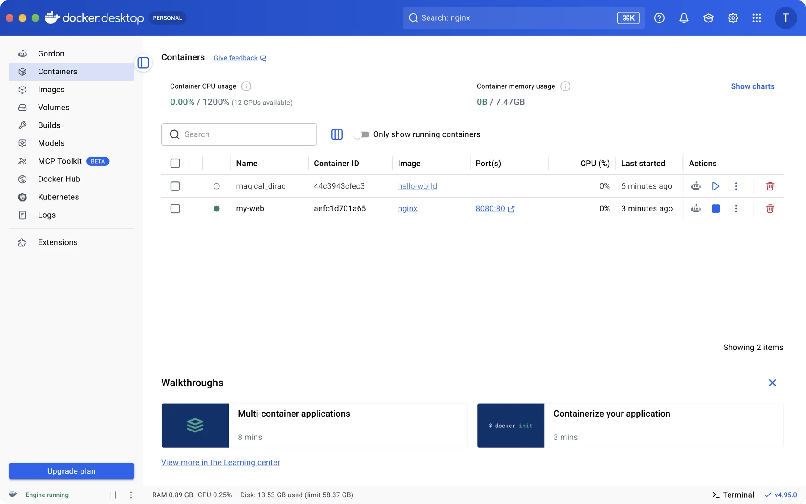
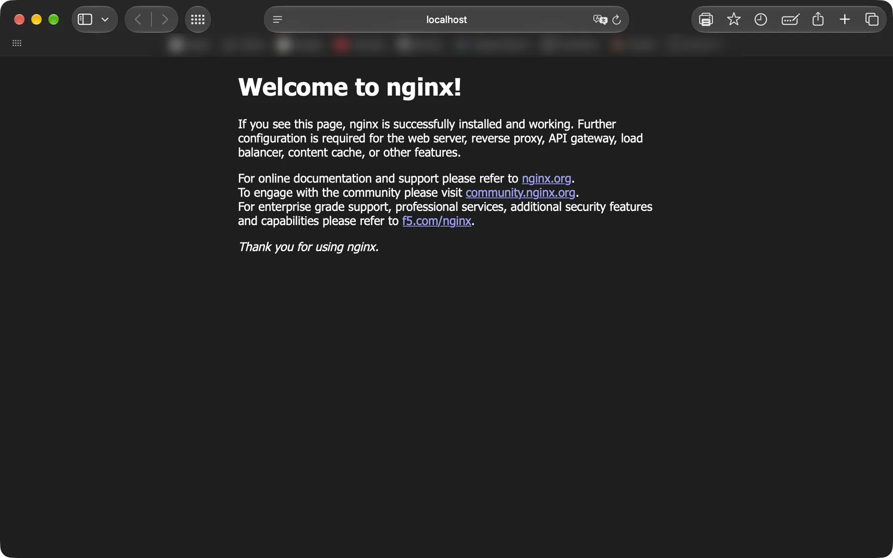
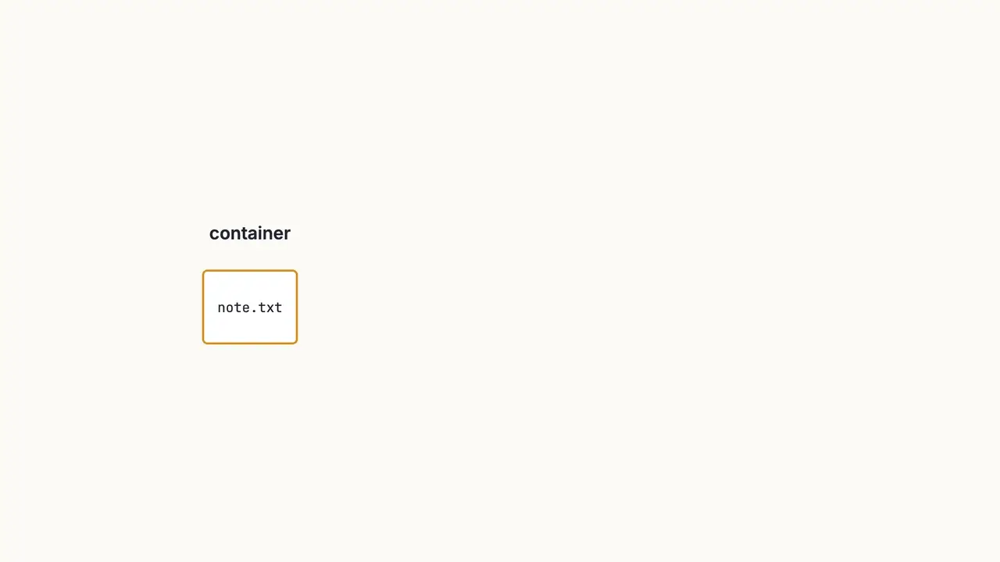

# 🐳 Docker 新手圖解教學

> 從零開始認識 Docker Desktop：裝好它、跑第一個容器、架一個網頁伺服器，一路到用 Compose 一次開好幾個容器。

### 👉 [直接線上閱讀教材](https://tinggeorge.github.io/docker-beginner-guide/)

不用安裝任何東西，點開就能看。教材本身是英文，但每一步都有截圖和動畫，跟著做就好。

---

## 📦 Docker 到底在解決什麼問題？

「在我電腦上明明可以跑啊！」——因為別台電腦裝的版本不一樣。
Docker 把**程式和它需要的所有東西**一起打包，搬到哪台電腦都能跑。

兩個最重要的名詞：

- **Image（映像檔）**：像一份食譜，唯讀、一層一層疊起來。
- **Container（容器）**：照著食譜做出來、正在跑的那一份。同一份食譜可以做很多份。


容器共用同一個 Linux 核心，所以比虛擬機輕巧很多：


---

## 🗺️ 教材內容

| # | 章節 | 你會學到 |
|---|------|---------|
| 0 | The big idea | Image、Container 是什麼 |
| 1 | Set up Docker Desktop | 安裝、確認 Engine 有在跑、常用設定 |
| 2 | Your first container | 跑 `hello-world` |
| 3 | Run a real web server | 找 image、用 `-p` 開 port、在瀏覽器打開 |
| 4 | Look inside a container | Logs、Inspect、Exec、Files、Stats |
| 5 | Keep data with volumes | 容器刪掉了，資料還在 |
| 6 | Docker Compose | 一個檔案、一行指令，開好整組服務 |
| 7 | Stop, start & clean up | 停止、刪除、清空間 |
| 8 | Useful features & tips | Docker Scout、Extensions、選單列小鯨魚 |
| ★ | Cheat sheet | 按鈕 ↔ 指令 對照表 |

---

## 🖼️ 搶先看

**在自己的 Mac 上架一個網頁伺服器**，Docker Desktop 裡看得到它在跑：



打開瀏覽器就能看到：



**Port 對應**：容器預設是封閉的，`-p` 幫它開一扇門。


**Volume**：沒有 volume，資料會跟著容器一起消失；有了 volume，新容器也看得到同一份檔案。



**Docker Compose**：一個檔案、一個指令，整組服務一起開。


---

## 🎬 比較想看影片？

[`docker_desktop_guide.mp4`](docker_desktop_guide.mp4) 是整份教材的影片版，[線上教材](https://tinggeorge.github.io/docker-beginner-guide/)最上方也可以直接播放。

---

## 📁 檔案說明

| 檔案 | 說明 |
|------|------|
| `index.html` | 教材本體（單一檔案，圖片都內嵌在裡面，可直接用瀏覽器打開） |
| `docker_desktop_guide.mp4` | 影片版教材 |
| `images/` | 這份 README 用的插圖 |

## 💻 離線閱讀

```bash
git clone https://github.com/TingGeorge/docker-beginner-guide.git
open docker-beginner-guide/index.html
```
